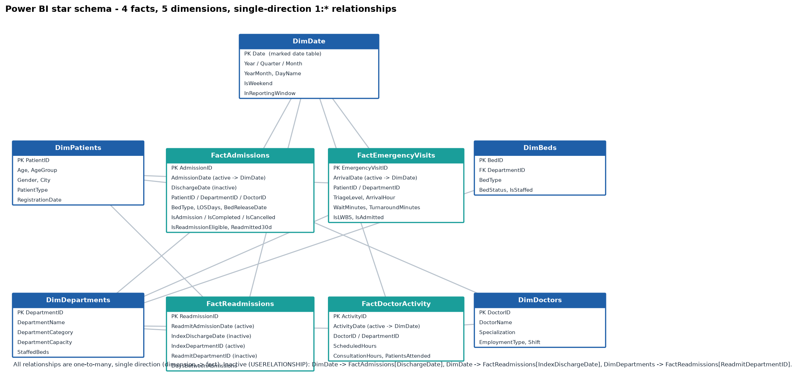
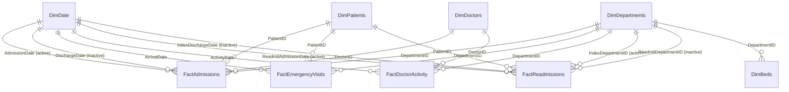

# Power BI Data Model (Star Schema)

Source files: `data/processed/powerbi/*.csv`, produced by `scripts/build_star_schema.py` from the cleaned data. Row counts: FactAdmissions 16,314 · FactEmergencyVisits 35,713 · FactDoctorActivity 44,214 · FactReadmissions 1,866 · DimPatients 27,007 · DimDepartments 11 · DimDoctors 58 · DimBeds 106 · DimDate 1,157.

## Relationships

| # | From (1) | To (*) | Active | Cross-filter | Used for |
|---|----------|--------|:------:|:------------:|----------|
| 1 | DimDate[Date] | FactAdmissions[AdmissionDate] | Yes | Single | admissions, occupancy iteration |
| 2 | DimDate[Date] | FactAdmissions[DischargeDate] | **No** | Single | discharges, ALOS, readmission rate (`USERELATIONSHIP`) |
| 3 | DimDate[Date] | FactEmergencyVisits[ArrivalDate] | Yes | Single | ED volume, waits |
| 4 | DimDate[Date] | FactDoctorActivity[ActivityDate] | Yes | Single | utilisation |
| 5 | DimDate[Date] | FactReadmissions[ReadmitAdmissionDate] | Yes | Single | readmission patterns by month of return |
| 6 | DimDate[Date] | FactReadmissions[IndexDischargeDate] | **No** | Single | patterns by index-discharge month |
| 7 | DimDepartments[DepartmentID] | FactAdmissions[DepartmentID] | Yes | Single | |
| 8 | DimDepartments[DepartmentID] | FactEmergencyVisits[DepartmentID] | Yes | Single | ED team the visit was routed to |
| 9 | DimDepartments[DepartmentID] | FactDoctorActivity[DepartmentID] | Yes | Single | |
| 10 | DimDepartments[DepartmentID] | FactReadmissions[IndexDepartmentID] | Yes | Single | |
| 11 | DimDepartments[DepartmentID] | FactReadmissions[ReadmitDepartmentID] | **No** | Single | flow matrix (`USERELATIONSHIP`) |
| 12 | DimDepartments[DepartmentID] | DimBeds[DepartmentID] | Yes | Single | staffed-bed denominator follows the department slicer |
| 13 | DimDoctors[DoctorID] | FactAdmissions[DoctorID] | Yes | Single | admissions per attending |
| 14 | DimDoctors[DoctorID] | FactDoctorActivity[DoctorID] | Yes | Single | utilisation per doctor |
| 15-17 | DimPatients[PatientID] | FactAdmissions / FactEmergencyVisits / FactReadmissions | Yes | Single | demographics |

## Design decisions (and why)

1. **Four separate fact tables, never joined to each other.** They have different grains (admission, ED visit, doctor-day, readmission pair). Joining them would multiply rows (a patient with 3 admissions x 5 ED visits = 15 rows). Facts meet only through shared dimensions, so each measure sums exactly one fact.
2. **No ambiguous paths.** Each dimension reaches each fact by exactly one active path. To keep it that way:
   - `DimDoctors` and `DimDepartments` are **not** related (a doctor-to-department link would create a second path from DimDepartments to FactAdmissions). Instead `DepartmentID` is carried on `FactDoctorActivity`.
   - `DimBeds` is **not** related to `FactAdmissions` (would give DimDepartments two paths). `BedType` is denormalised onto `FactAdmissions` for bed-type visuals; `DimBeds` supplies capacity.
3. **Role-playing dates via inactive relationships.** Admission and discharge dates both point at DimDate; discharge-based measures call `USERELATIONSHIP`. No duplicate calendar tables are needed.
4. **Single-direction filtering everywhere.** No bidirectional relationship is required. (If you want a slicer on a fact attribute such as `AdmissionType` to also narrow a dimension list, use a visual-level filter instead of bi-directional filtering.)
5. **Readmission flags on the index admission** (`IsReadmissionEligible`, `FollowupComplete`, `Readmitted30d`) so the rate's numerator and denominator are the same grain; `FactReadmissions` supplies the descriptive patterns.
6. **Calendar:** `DimDate` is a complete, contiguous table (2022-11-01 .. 2025-12-31). *Table tools > Mark as date table > Date.* Sort `MonthName` by `MonthNumber`, `YearMonth` by `YearMonthSort`, `DayName` by `DayOfWeekNumber`.
7. **Reporting window.** Admissions before 2023-01-01 are carry-over inpatients from the simulation burn-in; they matter only for occupancy. A report-level filter `DimDate[InReportingWindow] = TRUE` hides them from volume KPIs.
8. **Hide** technical columns in report view (keys, `BedReleaseDate`, `InReportingWindow`, flag columns used only in measures) and put all measures in `_Measures`.

## Data types (Power Query)
Dates -> *Date*; `ArrivalDateTime/ConsultationDateTime/DispositionDateTime` -> *Date/Time*; `Is*`, `FollowupComplete`, `Readmitted30d`, `Within30Days`, `FromED`, `InReportingWindow` -> *True/False*; `WaitMinutes`, `TurnaroundMinutes`, hours -> *Decimal*; `LOSDays`, counts, `ArrivalHour`, `TriageLevel` -> *Whole number*. `MetWaitTarget` -> *Whole number* (blank for LWBS).

## Refresh
Import mode. The CSV folder path is a parameter (`DataFolder`, see `power_query/load_tables.pq`); to refresh, re-run `scripts/build_star_schema.py` (or load from PostgreSQL) and press *Refresh*. For production use incremental refresh on `FactEmergencyVisits` and `FactDoctorActivity` (date-partitioned, append-only).
